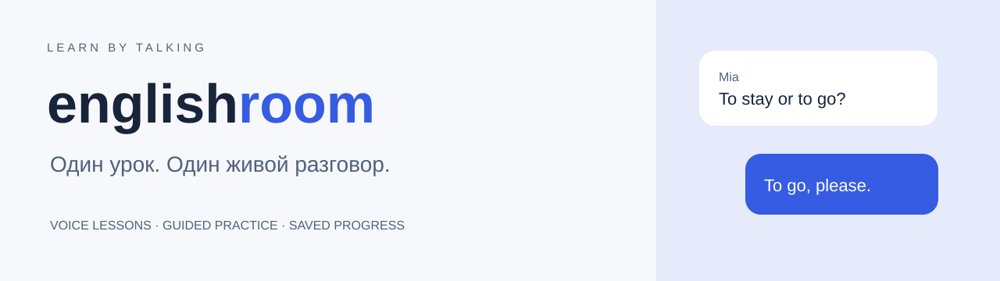
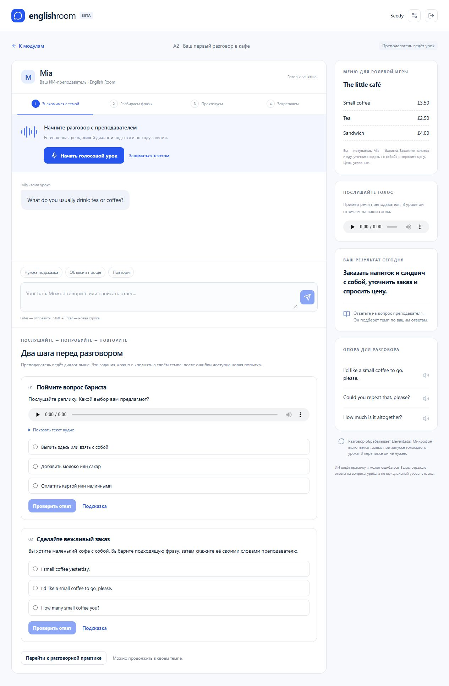

<p align="left"></p>

# English Room

**Голосовой ИИ-репетитор английского с короткими уроками и практикой в диалоге.**

[Обзор проекта](docs/CASE-STUDY.md) · [Локальный запуск](SETUP.md) · [Архитектура](docs/ARCHITECTURE.md) · [Методика урока](LESSON-METHOD.md)

  

## Что можно попробовать

Пробный урок A2 «В кафе»: понять вопрос бариста, выбрать вежливую фразу, заказать напиток и сэндвич, уточнить цену. Преподаватель ведёт четыре этапа — знакомство, полезные фразы, ролевой разговор и проверку. Можно говорить или писать; незавершённый урок сохраняется.



## Что реализовано

- Три стиля преподавания: Mia, Oliver и Zoe. Программа A1/A2/B1 и отдельный пробный урок.
- Голосовой и текстовый диалог через ElevenLabs; контекст включает тему, текущий этап, историю и выполненные задания.
- Клиентские инструменты агента переключают этапы и передают ответы на проверку. Правильные варианты остаются на сервере.
- D1 / SQLite хранит профиль, доступ к преподавателю, уроки, сообщения, записи на занятия и результаты.
- Сервер проверяет владельца урока и срок доступа; повторные запросы не дублируют попытки и сообщения.
- Задания на понимание речи и выбор фразы работают независимо от живого голосового подключения.

## Как устроен проект

| Часть | Файлы |
| --- | --- |
| Комната урока и голосовой клиент | `app/lesson-room.tsx` |
| Задания пробного урока | `app/trial-practice.tsx`, `lib/trial.ts` |
| Серверные действия и оценка | `app/api/room/route.ts` |
| Программа, стили и инструкции агента | `lib/curriculum.ts`, `lib/teaching.ts` |
| Схема хранения | `db/schema.ts`, `drizzle/` |
| Проверки поведения API | `tests/` |

## Запуск

Нужен Node.js 22.13+ (рекомендуется 24). После клонирования:

```sh
npm ci
npm run build
```

Затем примените локальную миграцию и запустите приложение по [инструкции](SETUP.md). Для живого диалога нужен **собственный агент ElevenLabs**. Его инструкции и инструменты описаны в репозитории; идентификатор аккаунта автора в код не включён. Без провайдера доступны интерфейс, материалы, аудиозадания и сохранение прогресса.

## Проверка

```sh
npm run typecheck
npm run build
node tests/api-flow.mjs
node tests/teacher-flow.mjs
node tests/trial-flow.mjs
```

Сценарии API выполняются на локальном Worker с тестовой базой: порядок запуска — в [SETUP.md](SETUP.md). Они проверяют состояния приложения и транспорт сообщений, а не качество живого произношения модели.

## Границы MVP

Доступ к преподавателям бесплатный; платежи не подключены. Вход в развёрнутой версии зависит от ChatGPT/Sites, локально используется тестовый профиль. Производственный сайт пока доступен владельцу; этот репозиторий открыт для изучения и локального запуска. ИИ может ошибаться, результат мини-теста не является оценкой CEFR. Экспорт и удаление пользовательских данных пока не реализованы.

**Лицензия:** [MIT](LICENSE) для собственного кода. Лицензии включённых компонентов сохранены в [THIRD-PARTY-NOTICES.md](THIRD-PARTY-NOTICES.md). Облачные сервисы и голоса предоставляются по отдельным условиям их провайдеров.
