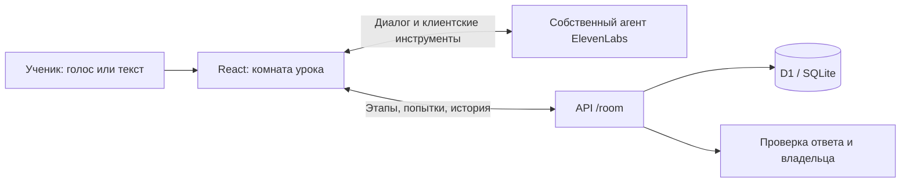

# Архитектура

## Граница доверия

Серверная сессия принадлежит конкретному пользователю. Перед записью проверяется владелец, завершённость занятия и срок доступа. Клиентские инструменты вызывают серверные действия; модель не записывает произвольный результат. Правильные варианты исключены из публичного контекста урока.

Вход через заголовки доверенного шлюза Sites нельзя переносить без проверки на произвольный публичный хостинг. Локальные сценарии используют искусственные идентификаторы и не запускаются на производственном сайте.

## Конфигурация

Инструкции: `lib/teaching.ts`. Материалы: `lib/curriculum.ts`. Пробные задания: `lib/trial.ts`. ID провайдера берётся из привязки `ELEVENLABS_AGENT_ID`. Конфигурация размещения в репозитории не содержит ID производственного сайта.
